# 🛡️ Awesome VPN & Mesh Networking

  <strong>A curated directory of production-grade Mesh VPNs, Zero-Trust Overlay Networks, Software-Defined Perimeters (SDP), and Self-Hosted WireGuard Solutions.</strong>

  
  
  
  
  
  
  

---

## 📑 Table of Contents

- [🔍 SEO & Overview Summary](#-seo--overview-summary)
- [📊 Sector Overview & Market Dynamics](#-sector-overview--market-dynamics)
- [☁️ SaaS Products & Hosted Mesh Platforms](#️-saas-products--hosted-mesh-platforms)
- [🚀 Open-Source Mesh & VPN Projects (Ranked by Stars)](#-open-source-mesh--vpn-projects-ranked-by-stars)
  - [⚡ Mesh & Overlay Networks](#-mesh--overlay-networks)
  - [🛠️ WireGuard Tools & Management UIs](#️-wireguard-tools--management-uis)
  - [🏛️ Classical VPN Daemons & Multi-Protocol Servers](#️-classical-vpn-daemons--multi-protocol-servers)
  - [📦 Automated VPN Deployers & Road Warrior Scripts](#-automated-vpn-deployers--road-warrior-scripts)
  - [🌐 Decentralized & Encrypted Mesh Networks](#-decentralized--encrypted-mesh-networks)
- [🎯 Technology Selection Matrix](#-technology-selection-matrix)
- [🤝 How to Contribute](#-how-to-contribute)
- [💖 Support & Community](#-support--community)
- [  Star History](#--star-history)
- [⚖️ Disclaimer & License](#️-disclaimer--license)

---

## 🔍 SEO & Overview Summary

Welcome to the ultimate, search-optimized guide to **Mesh VPNs**, **Zero-Trust Network Access (ZTNA)**, **Software-Defined Perimeters (SDP)**, and **Encrypted Overlay Networks**. 

Traditional centralized hub-and-spoke corporate VPNs introduce single points of failure, latency chokepoints, and security risks by granting broad perimeter network access. Modern **peer-to-peer (P2P) mesh networking** revolutionizes connectivity by establishing direct, end-to-end encrypted tunnels between nodes using lightweight, modern cryptography protocols such as **WireGuard®** and **Noise Protocol Framework**. Devices can securely communicate across firewalls and NATs without manual port forwarding or complex routing tables.

### 🏷️ Search Keywords
`vpn`, `mesh-vpn`, `mesh-networking`, `wireguard`, `tailscale`, `headscale`, `zerotier`, `netbird`, `nebula`, `zero-trust`, `ztna`, `software-defined-perimeter`, `sd-wan`, `overlay-network`, `peer-to-peer`, `p2p-vpn`, `nat-traversal`, `self-hosted-vpn`, `openvpn`, `ipsec`, `encrypted-tunnel`, `secure-remote-access`.

---

## 📊 Sector Overview & Market Dynamics

The global enterprise secure remote access, Zero Trust Network Access (ZTNA), and secure overlay networking market is estimated between **$45 billion and $55 billion**, expanding at a rapid compound annual growth rate (**CAGR of 16% to 22%**) toward an expected **$90+ billion**.

From an industry structure perspective, the sector exhibits **moderate fragmentation characterized by a barbell distribution**:
- **Enterprise Hyperscalers & Cybersecurity Giants**: Companies like Cloudflare, Check Point (Perimeter 81), Cisco, and Palo Alto Networks dominate enterprise edge security and broad SASE architectures, catering to multi-national corporations requiring strict regulatory compliance, global Anycast points of presence, and DLP (Data Loss Prevention).
- **Agile, Developer-First P2P Mesh Pioneers**: Innovators such as Tailscale, NetBird, ZeroTier, and Defined Networking have disrupted the traditional VPN landscape through frictionless NAT traversal (DERP, ICE, STUN/TURN), sub-second connection setup, and developer-friendly access control lists (ACLs as code). The presence of fully capable open-source controllers (e.g., Headscale) ensures that users retain sovereignty, preventing vendor lock-in and driving healthy competitive evolution across the sector.

---

## ☁️ SaaS Products & Hosted Mesh Platforms

The following commercial and managed platforms deliver hosted control planes, automated NAT traversal, identity provider (IdP) integration, and Zero-Trust access control for secure mesh overlay networks.

> *Sorted descending by company valuation / market capitalization.*

| 🏢 Platform & Provider | 📈 Company Size (Valuation / Revenue) | 💳 Starting Tier Price | 🎁 Free Tier Limit / Free Trial Plan | ✨ Core Mesh & Security Capabilities |
| :--- | :--- | :--- | :--- | :--- |
| [**Cloudflare Zero Trust / Magic WAN**](https://www.cloudflare.com/products/zero-trust/)   *(Cloudflare, Inc. - NYSE: NET)* | **~$115 Billion** market cap   *($2.2B+ ARR)* | **$7.00 / user / month**   *(Standard plan)* | **Free Forever**: Up to 50 users, 3 network locations, and 24 hours of activity audit logging | Global Anycast network routing, WireGuard-powered Cloudflare WARP client, Secure Web Gateway, and browser isolation. |
| [**Perimeter 81**](https://www.perimeter81.com/)   *(Check Point Software - NASDAQ: CHKP)* | **~$24 Billion** market cap   *($2.5B+ ARR)* | **$8.00 / user / month**   *(Essentials plan; min 5 users)* | **14-Day Free Trial**: Guided PoC with full network access for up to 10 users | Enterprise Zero-Trust Network Access (ZTNA), dedicated gateways with static IPs, device posture checks, and cloud firewall. |
| [**NordLayer**](https://nordlayer.com/)   *(Nord Security)* | **~$3.0 Billion** valuation   *($200M+ ARR)* | **$8.00 / user / month**   *(Lite plan, billed annually)* | **14-Day Free Trial**: Full feature access for up to 10 team seats with dedicated onboarding | Business VPN and SASE framework with multi-cloud bridging, AES-256 and NordLynx (WireGuard) encryption, and biometric 2FA. |
| [**Tailscale**](https://tailscale.com/)   *(Tailscale Inc.)* | **~$1.2 Billion** valuation   *($100M+ funding, $40M+ ARR)* | **$6.00 / user / month**   *(Personal Plus / Starter plan)* | **Free Forever**: Up to 3 users, 100 devices, 3 subnet routers, and MagicDNS | Seamless WireGuard mesh connectivity, zero-config DERP relay fallback, ACL policies as code, Tailscale SSH, and Funnel. |
| [**OpenVPN CloudConnexa**](https://openvpn.net/cloud-vpn/)   *(OpenVPN Inc.)* | **~$500 Million** valuation   *($50M+ ARR)* | **$7.00 / connection / month**   *(Standard plan, billed annually)* | **Free Forever**: 3 simultaneous connected devices / connections, 3 network connectors | Virtualized worldwide private overlay (DCO accelerated), DNS-based content filtering, application-domain routing, and IdP SSO. |
| [**Twingate**](https://www.twingate.com/)   *(Twingate Inc.)* | **~$300 Million** valuation   *($67M funding)* | **$5.00 / user / month**   *(Teams plan, billed annually)* | **Free Forever (Starter)**: Up to 5 users, 1 remote network, 1 connector, 2 devices per user | Software-Defined Perimeter (SDP) architecture, split-tunneling, zero exposed public IP addresses, and frictionless universal SSO. |
| [**ZeroTier**](https://www.zerotier.com/)   *(ZeroTier, Inc.)* | **~$150 Million** valuation   *($15M+ ARR)* | **$5.00 / month**   *(Basic plan; includes 25 nodes, +$0.20/node)* | **Free Forever**: Up to 25 connected devices/nodes, 1 administrator, community support | Layer-2 virtual Ethernet switch over the internet, cryptographically verified node addressing, and multi-cloud bridging. |
| [**GoodAccess**](https://www.goodaccess.com/)   *(GoodAccess s.r.o.)* | **~$80 Million** valuation   *($10M+ ARR)* | **$7.00 / user / month**   *(Essential plan; min 5 users)* | **14-Day Free Trial**: Full enterprise access, 1 dedicated gateway with static IP, up to 10 user seats | Cloud VPN with dedicated static IP address, Software-Defined Perimeter, SaaS application whitelisting, and split-tunneling. |
| [**NetBird Cloud**](https://netbird.io/)   *(NetBird GmbH)* | **~$50 Million** valuation   *($5M+ funding)* | **$5.00 / user / month**   *(Team plan)* | **Free Forever**: Up to 5 peers, 1 user seat, community support, full mesh WireGuard routing | Modern open-source-first overlay network with kernel WireGuard, WebRTC ICE NAT traversal, posture checks, and route failover. |
| [**Defined Networking**](https://www.defined.net/)   *(Defined Networking, Inc.)* | **~$30 Million** valuation   *(Seed-stage funding)* | **$5.00 / host / month**   *(Professional plan)* | **Free Forever**: Up to 5 hosts / devices, unlimited mesh networks, community support | Managed Slack Nebula mesh overlays, automated certificate authority (CA) generation, and multi-cloud enterprise interconnects. |

---

## 🚀 Open-Source Mesh & VPN Projects (Ranked by Stars)

The following open-source projects power production overlay networks, WireGuard mesh networks, and secure tunnels around the world.

> *Sorted descending by exact GitHub stargazer count.*

| 🏆 Rank | 📦 Repository & Link | ⭐ GitHub Stars (Live Badge) | 💻 Primary Stack | 🎯 Core Description & Highlights |
| :---: | :--- | :---: | :--- | :--- |
| **1** | [**juanfont/headscale**](https://github.com/juanfont/headscale) |  | Go | The premier open-source, self-hosted implementation of the Tailscale control server; complete data privacy without third-party coordination servers. |
| **2** | [**tailscale/tailscale**](https://github.com/tailscale/tailscale) |  | Go | The official Tailscale client daemon and command-line utilities; connects machines into peer-to-peer WireGuard meshes using MagicDNS and NAT traversal. |
| **3** | [**trailofbits/algo**](https://github.com/trailofbits/algo) |  | Python / Ansible | Automated deployment script to build personal, highly secure WireGuard and IPsec VPN servers in DigitalOcean, AWS, GCP, or Azure with modern defaults. |
| **4** | [**netbirdio/netbird**](https://github.com/netbirdio/netbird) |  | Go | Open-source Zero-Trust mesh networking platform utilizing WireGuard and WebRTC ICE for seamless direct NAT-to-NAT connections and SSO integration. |
| **5** | [**hwdsl2/setup-ipsec-vpn**](https://github.com/hwdsl2/setup-ipsec-vpn) |  | Shell / Docker | Highly popular automated scripts and Docker containers to set up IPsec/L2TP, Cisco IPsec, and IKEv2 VPN servers in minutes. |
| **6** | [**wg-easy/wg-easy**](https://github.com/wg-easy/wg-easy) |  | TypeScript / Shell | The easiest, all-in-one Docker image for running a WireGuard VPN server bundled with a responsive, modern web-based management UI and QR code generator. |
| **7** | [**StreisandEffect/streisand**](https://github.com/StreisandEffect/streisand) |  | Shell / Ansible | Automated multi-protocol VPN setup (WireGuard, OpenVPN, Shadowsocks, Tor bridge) with customized client connection manuals. |
| **8** | [**slackhq/nebula**](https://github.com/slackhq/nebula) |  | Go | Mutually authenticated peer-to-peer overlay network developed by Slack; scales to tens of thousands of locations using certificate-based discovery lighthouses. |
| **9** | [**zerotier/ZeroTierOne**](https://github.com/zerotier/ZeroTierOne) |  | C++ | Creates virtual peer-to-peer Ethernet networks (Layer 2) that function as a single global switch across clouds, containers, and IoT hardware. |
| **10** | [**amnezia-vpn/amnezia-client**](https://github.com/amnezia-vpn/amnezia-client) |  | C++ / Qt | Multi-platform, self-hosted VPN client with advanced anti-censorship protocols (AmneziaWG, OpenVPN over Cloak, ShadowSocks, WireGuard). |
| **11** | [**OpenVPN/openvpn**](https://github.com/OpenVPN/openvpn) |  | C | The foundational, battle-tested open-source SSL/TLS VPN daemon providing universal routing, multi-platform support, and Data Channel Offload (DCO). |
| **12** | [**SoftEtherVPN/SoftEtherVPN**](https://github.com/SoftEtherVPN/SoftEtherVPN) |  | C | Ultra-fast cross-platform multi-protocol VPN engine supporting OpenVPN, IPsec, L2TP, MS-SSTP, and native SoftEther packets through NAT and firewalls. |
| **13** | [**gravitl/netmaker**](https://github.com/gravitl/netmaker) |  | Go | High-throughput WireGuard overlay network orchestrator designed for distributed Kubernetes clusters, multi-cloud VPC peering, and site-to-site meshes. |
| **14** | [**angristan/wireguard-install**](https://github.com/angristan/wireguard-install) |  | Shell | Battle-tested Bash script to automatically install, configure, and manage WireGuard servers and client profiles on Debian, Ubuntu, AlmaLinux, and CentOS. |
| **15** | [**firezone/firezone**](https://github.com/firezone/firezone) |  | Rust / Elixir | Next-generation Zero-Trust access platform built from scratch in Rust with WireGuard tunnels, granular resource-level policies, and OIDC auth. |
| **16** | [**mullvad/mullvadvpn-app**](https://github.com/mullvad/mullvadvpn-app) |  | Rust / Electron | Privacy-first, open-source VPN desktop and mobile client engineered by Mullvad with multi-hop WireGuard, kill-switch, and post-quantum defenses. |
| **17** | [**tonarino/innernet**](https://github.com/tonarino/innernet) |  | Rust | Private mesh overlay system built on WireGuard with an emphasis on CIDR-based micro-segmentation, subnets, and human-readable peer names. |
| **18** | [**yggdrasil-network/yggdrasil-go**](https://github.com/yggdrasil-network/yggdrasil-go) |  | Go | Compact, end-to-end encrypted IPv6 mesh routing protocol implementing a decentralized routing scheme that operates automatically across untrusted networks. |
| **19** | [**cjdelisle/cjdns**](https://github.com/cjdelisle/cjdns) |  | C | Pioneering encrypted IPv6 network leveraging public-key cryptography for host addressing, dynamic routing, and decentralized peer-to-peer mesh. |
| **20** | [**pritunl/pritunl**](https://github.com/pritunl/pritunl) |  | Python | Enterprise-grade OpenVPN and WireGuard management server with multi-cloud site-to-site bridging, dual-factor authentication, and Web UI. |
| **21** | [**Nyr/wireguard-install**](https://github.com/Nyr/wireguard-install) |  | Shell | Minimalist, robust WireGuard installer script supporting all major Linux distributions with instant QR code client profile generation. |
| **22** | [**meshbird/meshbird**](https://github.com/meshbird/meshbird) |  | Go | Distributed, decentralized private networking tool designed to connect servers across clouds, datacenters, and edge locations in a peer mesh. |
| **23** | [**DefGuard/defguard**](https://github.com/DefGuard/defguard) |  | Rust / React | Enterprise Zero-Trust access and identity management portal with true 2FA/MFA WireGuard routing, desktop clients, and YubiKey support. |
| **24** | [**subspacecloud/subspace**](https://github.com/subspacecloud/subspace) |  | HTML / Go | Simple, clean web administrative dashboard for managing WireGuard peers, generating QR code configurations, and SAML integration. |
| **25** | [**gsliepen/tinc**](https://github.com/gsliepen/tinc) |  | C | The classic Virtual Private Network (VPN) daemon that automatically creates a full-mesh topology across disparate internet sites without a central relay. |
| **26** | [**costela/wesher**](https://github.com/costela/wesher) |  | Go | Zero-configuration WireGuard overlay mesh network manager using Memberlist (gossip protocol) for automatic peer discovery and key exchange. |

---

## 🎯 Technology Selection Matrix

| Use Case / Scenario | Recommended Solution | Rationale & Architecture Highlight |
| :--- | :--- | :--- |
| **Self-Hosted Tailscale Control Plane** | [**Headscale**](https://github.com/juanfont/headscale) | Compatible with official Tailscale clients while maintaining 100% control over node coordination and private encryption keys. |
| **Zero-Configuration HomeLab & Remote Access** | [**Tailscale**](https://tailscale.com/) or [**NetBird**](https://github.com/netbirdio/netbird) | Frictionless NAT traversal via DERP/STUN relays; connects laptops, mobile devices, NAS, and Raspberry Pis without opening router ports. |
| **Large-Scale Multi-Cloud Mesh (Thousands of Nodes)** | [**Slack Nebula**](https://github.com/slackhq/nebula) | High scalability with lightweight lighthouse discovery beacons; proven in massive enterprise production environments. |
| **Layer-2 Bridging & Virtual Ethernet LAN** | [**ZeroTier**](https://github.com/zerotier/ZeroTierOne) | Enables broadcast/multicast packets, mDNS, gaming LAN emulation, and industrial IoT protocols across WAN boundaries. |
| **Instant Single-Server WireGuard with Web UI** | [**WG-Easy**](https://github.com/wg-easy/wg-easy) | Single Docker container deployment with a sleek web UI, dynamic QR codes for mobile clients, and instant bandwidth stats. |
| **Enterprise Identity & Micro-Segmented Zero Trust** | [**Firezone**](https://github.com/firezone/firezone) or [**DefGuard**](https://github.com/DefGuard/defguard) | Granular resource-based access control, OpenID Connect (OIDC) Single Sign-On, and device posture verification. |
| **Automated VPS Bastion VPN Setup** | [**Algo VPN**](https://github.com/trailofbits/algo) or [**Angristan Script**](https://github.com/angristan/wireguard-install) | Hardened, unbloated security defaults with automated cloud provisioning and minimal server attack surface. |

---

## 🤝 How to Contribute

Contributions are warmly welcomed! Help keep this directory current, accurate, and valuable for network engineers, devops teams, and self-hosters worldwide:

1. 🍴 **Fork the Repository** on GitHub.
2. 🌿 **Create a Feature Branch** (`git checkout -b feature/add-mesh-vpn-tool`).
3. 📝 **Update [README.md](README.md)** with factual descriptions, official documentation URLs, star counts, and pricing tiers.
4. 🔍 **Verify Formatting**: Ensure SaaS entries are sorted by valuation descending, and Open-Source projects are sorted by exact star count descending.
5. 🚀 **Submit a Pull Request** with a concise explanation of your additions or amendments.

---

## 💖 Support & Community

If you found this curated list helpful for your network architecture, homelab setup, or security research, please consider supporting the project:

- ⭐ **Star this repository** to help other engineers discover it!
- 🍴 **Fork and share** with your teammates and network community.
- ☕ **Support continuous maintenance & updates**: Buy a coffee or sponsor ongoing curation via the [**GitHub Sponsors Dashboard**](https://github.com/sponsors/ishandutta2007).

  

---

##   Star History

---

## ⚖️ Disclaimer & License

- **Disclaimer**: This is an independent, community-maintained research collection and does not constitute an endorsement of any commercial platform or tool. Software pricing, feature tiers, and API limits are subject to change by respective vendors.
- **License**: Released under the [MIT License](LICENSE).
